<div align="center">


# Glup

**Una mascota que vive arriba de tu pantalla y te ayuda con tus archivos: fotos, PDF, audios y videos.
Gratis y sin internet.**

[](LICENSE)
[](https://github.com/rody-huancas/glup/releases/latest)
[](https://github.com/rody-huancas/glup/releases/latest)

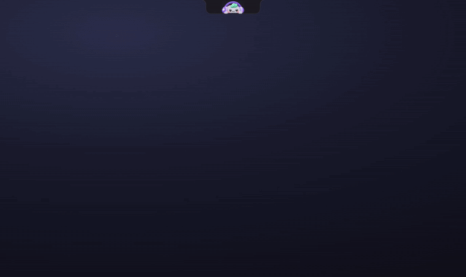

</div>

Glup es una pastilla pequeña en el borde de arriba de tu pantalla. Pasas el cursor y se abre; le sueltas
un archivo y se lo «come»: te muestra lo que puede hacer con él y lo hace en un momento, sin abrir
ningún programa ni subir nada a internet.

<p align="center">
  
  
</p>

<p align="center">
  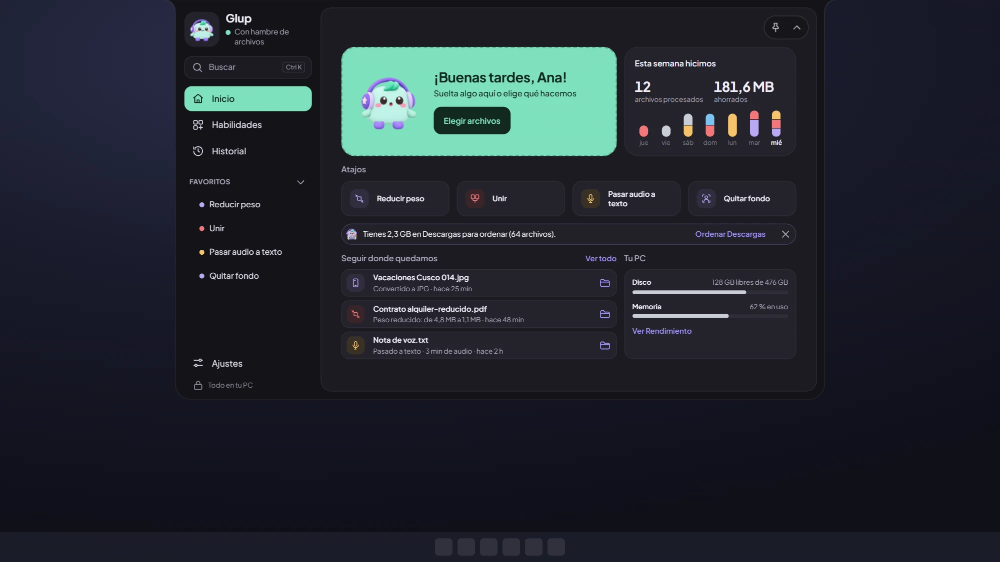
</p>

## Qué hace

Sus habilidades están en seis familias. Las encuentras en **Habilidades**, en el buscador (Ctrl+K), al
soltarle un archivo o con el clic derecho del Explorador de Windows («Glup» y «Enviar a › Glup»).

<p align="center">
  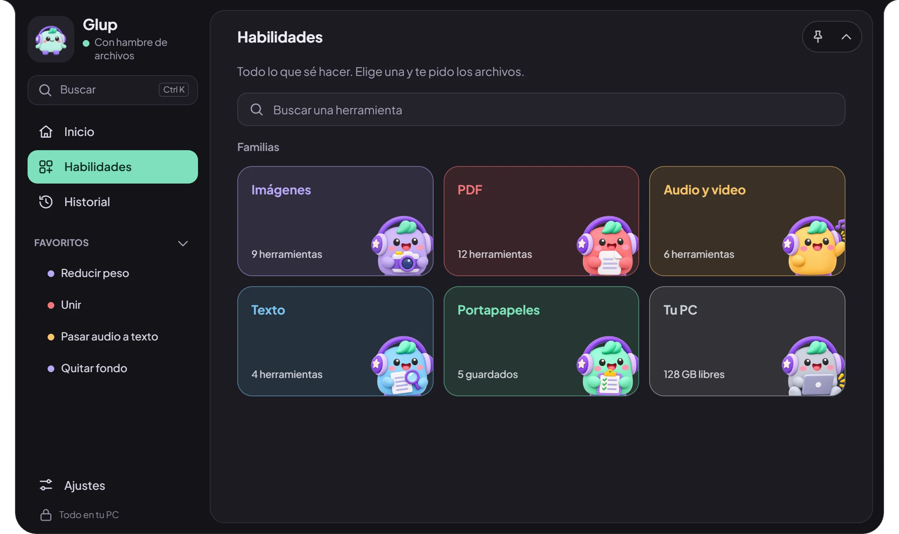
</p>

###  Imágenes

Tus fotos, más livianas o en otro formato, sin que se vean peor.

- **Convertir** a WebP, JPG o PNG.
- **Fotos de iPhone a JPG**: las HEIC a JPG, derechas y con su fecha.
- **Reducir peso**: la misma foto, pesando menos.
- **Quitar fondo**: deja solo lo importante, transparente o en blanco.
- **Tamaño para redes**: la medida justa para Instagram, WhatsApp, TikTok…
- **Marca de agua**: tu nombre o tu logo sobre tus fotos.
- **Mejorar calidad**: agranda fotos chicas o borrosas x2 o x4.
- **Foto tamaño carnet**: fondo blanco y la medida justa.
- **A PDF**: tus imágenes en un solo PDF.

###  PDF

Todo lo que se suele hacer con un PDF, sin páginas web de por medio.

- **Unir** varios en uno solo, y **Separar** todas o solo algunas páginas.
- **Organizar páginas**: gíralas, quítalas o cambia el orden.
- **Reducir peso**, **Firmar** donde quieras y pasarlo **A imágenes** (JPG o PNG).
- **Poner contraseña** y **Quitar contraseña** (solo si la sabes).
- **Marca de agua** («COPIA», «BORRADOR») y **Numerar páginas**.
- **Sacar imágenes**: guarda las fotos que trae el PDF.
- **Escanear documento**: fotos de hojas a un PDF recto y limpio.

<p align="center">
  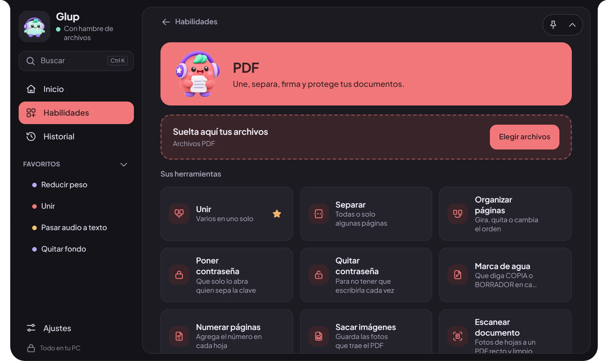
  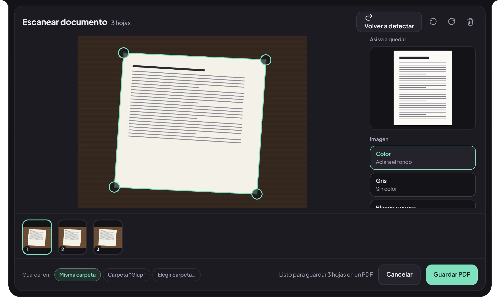
</p>

###  Audio y video

- **Reducir peso de video**: para mandarlo por WhatsApp o por correo.
- **Sacar el audio** de un video en MP3, M4A o WAV.
- **Recortar** un tramo de un audio o de un video.
- **Subtítulos**: escucho lo que se dice en un video y armo frases para que las revises antes de guardarlas.
- **Video a GIF**: un tramo del video como GIF o WebP animado.
- **Pasar audio a texto**: notas de voz, reuniones o clases.

<p align="center">
  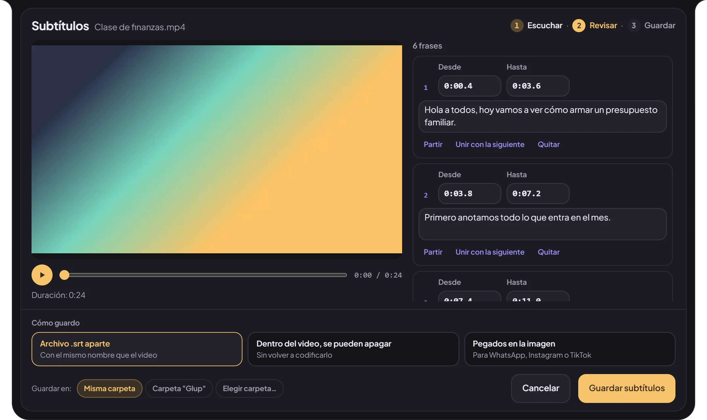
</p>

###  Texto

- **Sacar texto** de una foto, una captura o un PDF escaneado.
- **Copiar texto de la pantalla**: eliges una parte de la pantalla y copio lo que dice.
- **Crear un QR** para un enlace, tu WiFi, WhatsApp, un contacto o un correo, y **Leer un QR** de una
  imagen, un PDF, la pantalla o lo que copiaste.

###  Portapapeles

- **Portapapeles**: lo que copiaste, para buscarlo y copiarlo de nuevo. Está apagado hasta que lo
  enciendas, se guarda cifrado con tu cuenta de Windows y nunca guarda lo que Windows marca como privado.

<p align="center">
  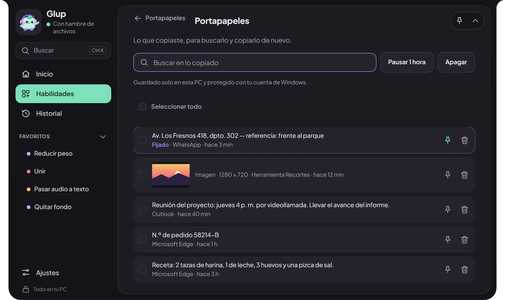
</p>

###  Tu PC

- **Limpieza**: haz espacio en tu PC.
- **Qué ocupa espacio**: un mapa de tu disco o de una carpeta, de lo más grande a lo más chico.
- **Archivos repetidos**: copias del mismo archivo, para liberar espacio.
- **Ordenar una carpeta**: Descargas u otra, en carpetas por tipo o por fecha.
- **Carpetas automáticas**: reglas para que haga algo solo cuando llega un archivo a una carpeta.
- **Renombrar en lote**: muchos archivos con nombres ordenados, y deshacerlo si quieres.
- **Juntar en ZIP** y **Rendimiento** (qué está usando tu PC y qué arranca con ella).

<p align="center">
  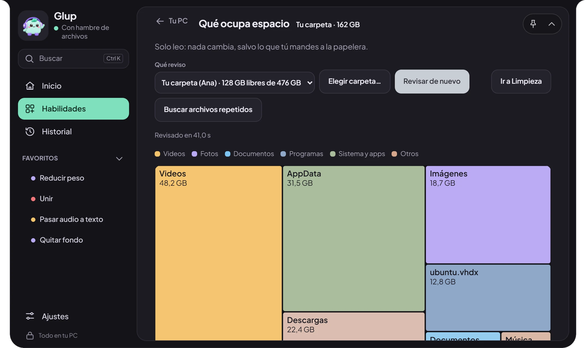
  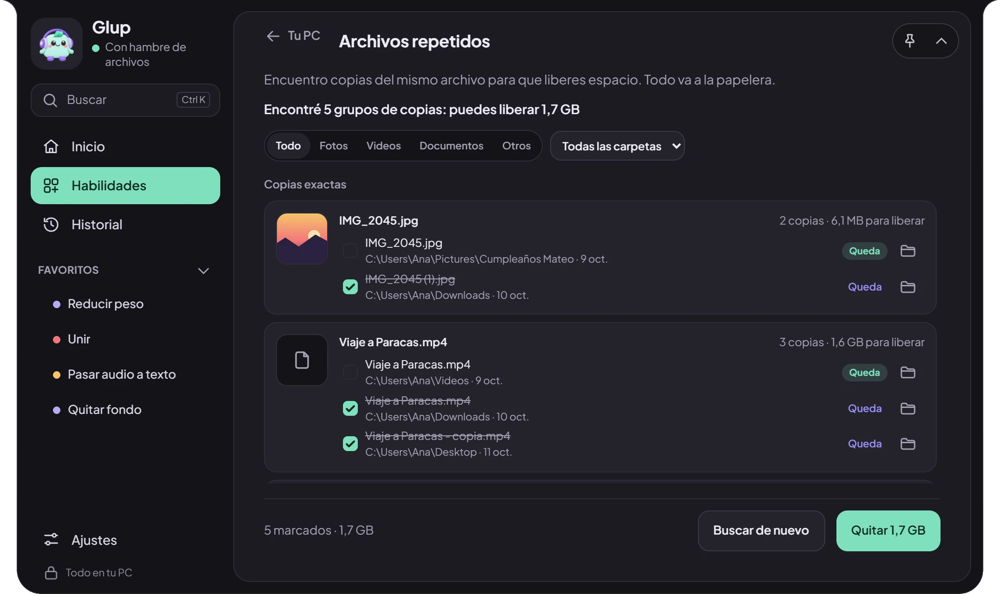
</p>

### Mientras trabaja

Cada tarea sigue aunque cierres el panel; Glup te avisa al terminar (en la isla o con una notificación de
Windows) y todo queda en el **Historial**, desde donde puedes abrir el resultado o deshacer lo que se
puede deshacer.

<p align="center">
  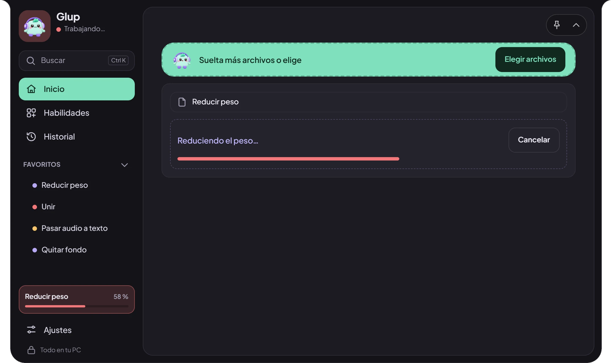
  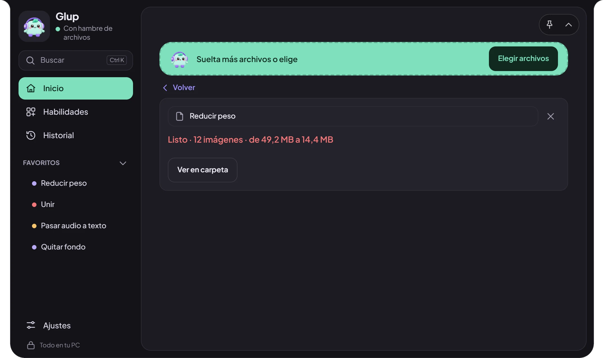
</p>

<p align="center">
  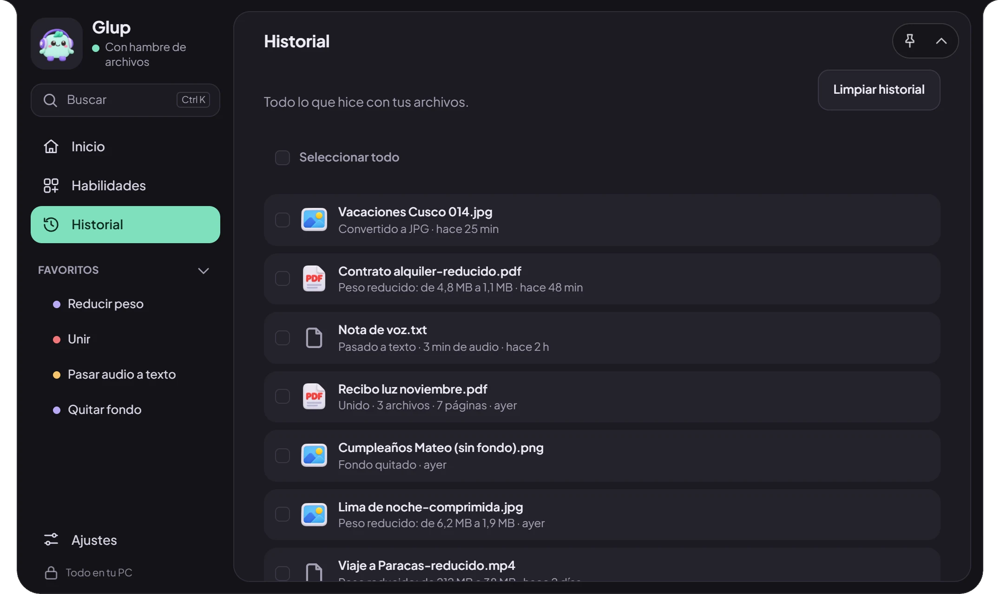
  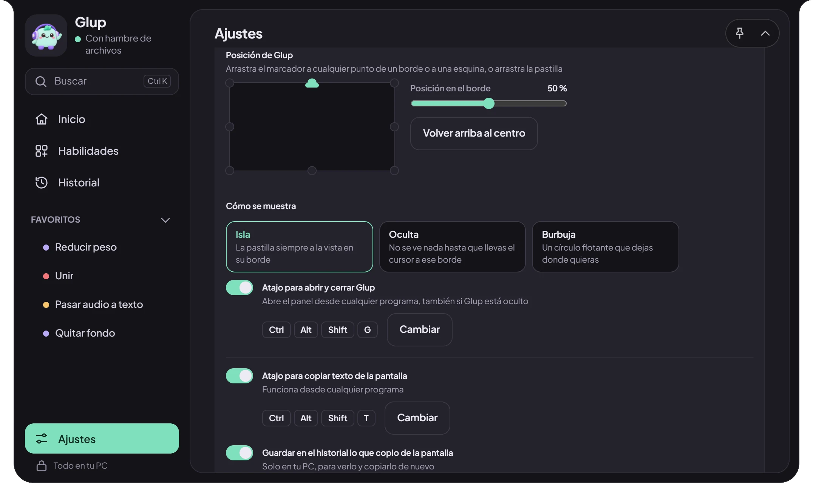
</p>

Glup puede vivir en cualquier borde o esquina de la pantalla, quedarse oculto hasta que acercas el cursor
o ser una burbuja que dejas donde quieras (Ajustes › Posición de Glup).

## Todo se queda en tu PC

Glup **nunca sube tus archivos** ni nada tuyo a internet: todo se hace en tu computadora. Tampoco toca
tus originales: lo que hace lo guarda como un archivo nuevo, y lo que mandas a borrar va a la papelera.

Algunas habilidades necesitan una herramienta que no viene en el instalador, para que este sea liviano. La
primera vez que hace falta, Glup **te pregunta antes**, te dice cuánto pesa y que es una sola vez; puedes
decir «Ahora no». Se descarga de una dirección fija, se comprueba que llegó entera y se guarda en la
carpeta de Glup. En **Ajustes › Lo que aprendí** ves cuánto ocupa y puedes borrarla.

| Qué se descarga | Para qué | Peso |
| --- | --- | --- |
| FFmpeg | Videos, audios y las fotos de iPhone que Windows no abre | unos 52 MB |
| Modelo de «Quitar fondo» | Quitar fondo y Foto tamaño carnet | 109 MB |
| Modelo para escuchar (rápido o más preciso) | Pasar audio a texto y Subtítulos | 181 MB o 514 MB |
| Modelo para agrandar (rápido o con más detalle) | Mejorar calidad | 4,6 MB o 64 MB |

Además de eso, lo único que hace con internet es mirar, en este mismo repositorio, si hay una versión
nueva. Solo se instala cuando tocas «Actualizar ahora».

## Cómo instalarlo

1. Entra a [la última versión](https://github.com/rody-huancas/glup/releases/latest) y descarga el
   instalador (el archivo que termina en `-setup.exe`).
2. Ábrelo y sigue los pasos. Glup aparece arriba de tu pantalla y en la bandeja, junto al reloj.

**Si sale una ventana azul que dice «Windows protegió tu PC»**: aparece con los programas nuevos que
todavía no son conocidos por Windows. Toca **«Más información»** y después **«Ejecutar de todas
formas»**. El instalador se arma solo en GitHub a partir de este código, que puedes revisar.

**Requisitos:** Windows 10 u 11 de 64 bits.

## Atajos de teclado

| Atajo | Qué hace |
| --- | --- |
| Ctrl+Alt+Shift+G | Abrir y cerrar Glup, desde cualquier programa |
| Ctrl+Alt+Shift+T | Copiar texto de la pantalla |
| Ctrl+Alt+Shift+H | Abrir el Portapapeles |
| Ctrl+K | Buscar una habilidad, una familia o un ajuste (con el panel abierto) |
| Esc o Alt+← | Volver a la pantalla anterior |

Los tres primeros se cambian o se apagan en Ajustes.

## Preguntas frecuentes

**¿Es gratis?**\
Sí, gratis y de código abierto. No tiene publicidad, cuentas ni versión de pago.

**¿Necesita internet?**\
No para trabajar. Solo la primera vez que una habilidad necesita descargar su herramienta (ver arriba), y
para mirar si hay una versión nueva.

**¿Por qué descarga cosas?**\
Porque esas herramientas pesan mucho y no todos las usan. Así el instalador es liviano y descargas solo lo
que vas a usar, siempre con permiso.

**¿Hay versión para Mac o Linux?**\
Por ahora no: Glup es para Windows 10 y 11.

**¿Cómo lo desinstalo?**\
En Configuración de Windows › Aplicaciones › Aplicaciones instaladas, busca «Glup» y elige
«Desinstalar». Se quitan también sus opciones del clic derecho. Si quieres liberar antes lo que
descargó, bórralo en Ajustes › Lo que aprendí.

## Para quien quiera ayudar

Glup está hecho con Tauri 2 (Rust) y React con TypeScript. Las reglas del proyecto, cómo proponer
cambios y cómo preparar el entorno están en [CONTRIBUTING.md](CONTRIBUTING.md).

Requisitos: [Rust](https://www.rust-lang.org/tools/install) (stable, con `rustup`),
[Node.js](https://nodejs.org) 20 o superior, [pnpm](https://pnpm.io/installation) 10, las
[Build Tools de C++](https://visualstudio.microsoft.com/visual-cpp-build-tools/) («Desarrollo para el
escritorio con C++») y, para whisper.cpp, [CMake](https://cmake.org/) y [LLVM](https://llvm.org/):
`winget install Kitware.CMake LLVM.LLVM`. Más detalles en los
[prerrequisitos de Tauri](https://tauri.app/start/prerequisites/).

```bash
pnpm install
pnpm dev          # la primera compilación de Rust tarda unos minutos
```

Las imágenes de este README salen de la interfaz real con datos de ejemplo: `pnpm docs:shots` las vuelve
a generar (ver CONTRIBUTING.md).

## Licencias

Glup es [MIT](LICENSE). Las piezas de terceros que usa (FFmpeg, los modelos, ONNX Runtime, whisper.cpp y
las demás) y sus licencias están en [THIRD_PARTY_NOTICES.md](THIRD_PARTY_NOTICES.md).

---

### In English

**Glup** is a free, open-source desktop mascot for Windows 10 and 11. It lives as a small pill at the top
edge of your screen; drop a file on it and it offers what it can do: convert and shrink photos (iPhone
HEIC included), merge, split, sign, compress and scan PDFs, shrink videos, extract audio, add subtitles,
turn speech into text, read and create QR codes, keep a clipboard history, find what takes space,
duplicates and more. Everything runs on your computer: no file ever leaves it. Some skills need a one-time
download (FFmpeg or a model), always asked first. Get the installer from
[Releases](https://github.com/rody-huancas/glup/releases/latest). The interface is in Spanish for now;
contributions in English are welcome (see [CONTRIBUTING.md](CONTRIBUTING.md)). MIT licensed.
